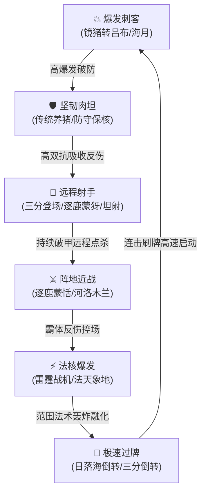

# 《王者万象棋》核心游戏机制与全棋手主流阵容适配白皮书

> **发布版本**：v1.9.1 环境白皮书（2026-11-09 修订版）  
> **研究对象**：腾讯《王者万象棋》（6人英雄策略对战/王牌对决模式）  
> **宗旨**：彻底厘清游戏底层运行机制、五大阵营动态词条与21位官方棋手的科学适配映射，杜绝虚构阵容、机械撞车与盲目推演。

---

## 一、 《王者万象棋》与传统自走棋的根本机制区别

《王者万象棋》并非传统的《云顶之弈》或《王者模拟战》，其底层运行逻辑有三大颠覆性创新：

### 1. 取消传统羁绊，全面采用「动态词条与技能连锁」
* **传统自走棋**：凑齐 3/6 个同阵营棋子提供全局固定攻击力/双抗 Buff。
* **万象棋机制**：**没有死板的人数堆叠羁绊**，英雄之间的联动完全依靠卡牌上的**核心关键词词条**（如【登场】、【整备】、【牺牲】、【图腾】、【战术牌】）。卡牌可以自由跨阵营混搭，只要关键词能形成闭环即可引爆连锁战力。

### 2. 等级上限无限制（“刷、养、炸”循环）
* 突破了传统自走棋“最高3星”的数值天花板。
* 英雄卡牌通过局内养成**等级可达 999 级**；当核心英雄突破 100 级时，将解锁震撼全场的**超级大招**（如吕布全屏霸体击飞、安琪拉三叉毁灭激光、蒙恬全军反伤巨盾）。低费卡在合理机制喂养下同样可以充当后期绝对大核。

### 3. 6人同场快节奏与无利息经济
* 固定为 **6 名玩家同场角逐**（初始生命值 60 点，而非 8 人自走棋）。
* 经济系统取消了复杂的吃息机制，倡导高频操作与快速升星，对局时长通常为 12~18 分钟。

---

## 二、 五大核心阵营与通用战术体系深入剖析

| 阵营 / 体系 | 核心关键词 / 机制特征 | 核心运转逻辑 | 主流赛场成型阵容 | 代表英雄 |
|---|---|---|---|---|
| **三分之地** | `登场`、`整备` | 依靠手牌入场或回合开始触发连锁等级跃迁；入场频率越高，核心等级滚雪球越快 | **【三分登场】** **【成年礼三分】** **【三分倒转】** | 曹操、赵云、周瑜、孙策、貂蝉 |
| **河洛** | `牺牲`、`古币` | 主动献祭或阵亡棋子产出专属古币，消耗古币直接购买专属战力或喂养单核大 C | **【牺牲李信】** **【河洛木兰】** **【多彩古币】** | 李信、花木兰、狄仁杰、武则天、司空震 |
| **大河流域** | `图腾`、`交锋` | 召唤阵营图腾协同作战；开局两军对撞自动触发“交锋”升级与大范围控制 | **【大河龙蛇】** **【大河山鬼】** | 东皇太一、鬼谷子、敖隐、虞姬、干将莫邪 |
| **逐鹿** | `战术牌`、`效果叠加` | 持续获取战术指令牌，永久赋予前排反伤或后排穿透属性，中后期成长稳定 | **【逐鹿蒙恬】** **【逐鹿蒙犽】** | 蒙恬、蒙犽、白起、廉颇、西施 |
| **日落海** | `临时等级`、`倒转` | 海都机械提供临时等级爆发；依托非觉醒牌高频打出实现极速刷牌与永动过牌 | **【日落海倒转】** **【转瞬快攻】** | 马可波罗、米莱狄、狂铁、海诺 |
| **通用 / 无阵营** | `单核喂养`、`法爆机甲`、`刺客突进` | 不依赖阵营标签，集中全队经济或护盾打造单核超级英雄；或利用特定棋手装备配件质变 | **【传统养猪】** **【镜猪转吕布】** **【雷霆战机】** **【稷下坦射】** | 猪八戒、牛魔、吕布、海月、孙膑、鲁班七号 |

---

## 三、 官方完整 21 位棋手机制与主流阵容适配矩阵

棋手拥有专属被动、主动秘技与升级天赋。棋手机制必须与阵容运转逻辑产生**乘积效应**，绝非随意套用。

### 1. 制造与极速刷牌类棋手（上限极高）
1. **乔汐（大乔+小乔）**：
   * **机制**：【温柔呼唤】（v1.9.1抽取 3~5 阶高质转瞬牌），【潮汐交响】（初始触发 4 次，单局稳定 +20 等级）。
   * **主推阵容**：**日落海倒转**、**三分倒转**。
   * **原理**：高阶转瞬牌极大加快倒转启动速度，法系与射手快攻成型神速。
2. **玉环（杨玉环）**：
   * **机制**：【霓裳风华】打出非觉醒牌获得高频连击与琴音治疗。
   * **主推阵容**：**日落海倒转**、**三分倒转**；备选 **牺牲李信**（连击加速单核李信爆发）。
   * **原理**：极速刷牌天然契合日落海与三分倒转，非觉醒牌连击让手牌利用率翻倍。
3. **嬴律（嬴政）**：
   * **机制**：【并购红利】（v1.9.1重做：合成 3 次满能量后，每回合稳定免费复制 1 张场上已有英雄）。
   * **主推阵容**：**逐鹿蒙恬**、**三分登场 / 成年礼三分**。
   * **原理**：回合稳定复制使高费高阶核心（蒙恬、曹操）追三星速度产生质变，彻底打破单核上限。
4. **安琪拉**：
   * **机制**：【打扫战场】飞行器继承（v1.9.1大幅提升至 125% 法攻、30% 攻速）。
   * **主推阵容**：**雷霆战机**、**法天象地**。
   * **原理**：飞行器高额法强攻速加成，引爆机甲法爆范围群伤，成为高坦前排的克星。
5. **孙小宾（孙膑）**：
   * **机制**：【时光倒流】回溯上回合手牌、定时炸弹延时群伤。
   * **主推阵容**：**雷霆战机**、**三分倒转**、**逐鹿蒙恬**。
   * **原理**：回溯关键手牌能重组关键机甲配件，极大延长过牌链。
6. **白歌**：
   * **机制**：【即兴创作】每 4 次合成额外复制 1 张卡牌。
   * **主推阵容**：**三分倒转**、**传统养猪**、**逐鹿蒙恬**。
   * **原理**：通过高频合成裂变出更多核心卡牌，加速追三与前排坦度成型。

### 2. 战术对抗与单核强化类棋手
7. **马可（马可波罗）**：
   * **机制**：【华丽弹幕】高频全屏真伤弹幕、压低敌方全体血线、击败夺宝增益。
   * **主推阵容**：**镜猪转吕布**、**逐鹿蒙犽**、**猪镜转李信**、**大河龙蛇**。
   * **原理**：真伤弹幕瞬间削弱前排血线，为刺客（吕布/海月）或单核李信创造极佳斩杀收割环境；配合蒙犽形成毁灭级物理双射手扫射。
8. **庄小鱼（庄周）**：
   * **机制**：【天人合一】全队免控、梦境护盾与解除负面效果。
   * **主推阵容**：**传统养猪**、**镜猪转吕布**。
   * **原理**：免控护体彻底解决养猪流最害怕的定身与眩晕集火，同时让切入型刺客（吕布）无阻碍释放大招。**严禁匹配三分登场**（毫无联动收益）。
9. **镜**：
   * **机制**：【开镜铜像】复刻上一张打出的英雄卡。
   * **主推阵容**：**镜猪转吕布**、**镜猪转海月**、**传统养猪**。
   * **原理**：铜像复刻高阶吕布或海月，形成双吕布全屏大招双击或双海月瞬爆法刺。
10. **武凤（武则天）**：
    * **机制**：【为我所用】（v1.9.1新棋手，45能量偷取敌方秘技牌，打破套路上限）。
    * **主推阵容**：**河洛木兰**、**逐鹿蒙恬**。
    * **原理**：偷取对手关键秘技化为己用，女帝爆发打破阵容被克制局限。
11. **香香（孙尚香）**：
    * **机制**：开战武器协同开火、物理重炮轰炸。
    * **主推阵容**：**逐鹿蒙犽**、**三分登场**、**稷下坦射**。
    * **原理**：协同开炮极大强化后排物理射手的集火能力。
12. **班叔（鲁班七号）**：
    * **机制**：【热能陷阱】真伤眩晕、弹簧防刺客贴脸、绝对保后排。
    * **主推阵容**：**稷下坦射**、**逐鹿蒙犽**。
    * **原理**：弹簧与陷阱专门克制近战刺客与吕布突进，给后排射手创造无死角的输出环境。
13. **姜导（姜子牙）**：
    * **机制**：【主角加冕】快速提升核心英雄等级与属性。
    * **主推阵容**：**逐鹿蒙恬**、**传统养猪**。
14. **阿离（公孙离）**：
    * **机制**：【红叶染锋】等级保留、高频位移生存。
    * **主推阵容**：**伞半月**、**日落海倒转**。
15. **明先生（明世隐）**：
    * **机制**：【丰节卦象】经济调控、卦象链子死保单核。
    * **主推阵容**：**传统养猪**、**河洛木兰**。
16. **瑶妹（瑶）**：
    * **机制**：小鹿庇护护盾、单核前排极限保活。
    * **主推阵容**：**传统养猪**、**防守保核**。
17. **诸葛亮**：
    * **机制**：【东风破】法球法术加成。
    * **主推阵容**：**三分登场**、**三分倒转**、**牺牲李信**。
18. **闹闹（哪吒）**：
    * **机制**：【阵营抉择】定向锁定阵营卡牌。
    * **主推阵容**：**三分登场**、**日落海倒转**、**大河龙蛇**。
19. **弈星**：
    * **机制**：【棋盘演练】借力打力反制敌方高阶卡。
    * **主推阵容**：**雷霆战机**、**日落海倒转**。
20. **常小娥（嫦娥）**：
    * **机制**：【月影灵泉】法盾与长线续航拉扯。
    * **主推阵容**：**日落海倒转**、**传统养猪**。
21. **司马懿**：
    * **机制**：突脸刺杀后排、打乱敌方节奏。
    * **主推阵容**：**三分倒转**、**刺客突进**。

---

## 四、 阵容相生相克生态博弈矩阵

在 6 人王牌对决中，六大战术流派形成闭环克制链：

* **刺客压制肉坦**：吕布真伤跳大直接无视纯肉护甲与护盾；
* **肉坦克制射手**：单核免控大猪吸收全部物理扫射，射手刮痧被拖垮；
* **射手克制战士**：远距离破甲点射让近战战士无法近身；
* **战士克制法核**：李信/蒙恬霸体反伤扛住第一波法术爆发后反向清场；
* **法核克制倒转**：雷霆机甲范围高法伤瞬间清空倒转薄弱后排；
* **倒转克制刺客**：极速过牌与护手控制在刺客启动前完成成型锁血。

---

## 五、 结论与系统推演守则

1. **绝对禁止**将非三分棋手（如庄小鱼、白歌、马可）全员推断为“三分登场”；
2. **绝对禁止**将口头整活语录（如“我不后悔”）作为独立官方阵容输出，其真实机制归属于【日落海极速倒转】；
3. 赛前推断必须遵循**「棋手专属机制 ➔ 禁选阵营剔除 ➔ 选手近7天实战熟练度 ➔ 权威绝活底蕴」**的四维严格推演链条。

