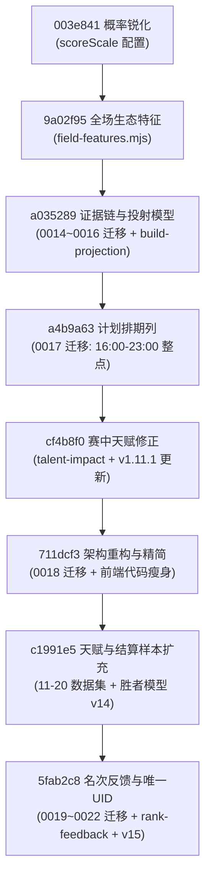

# 王者万象棋 · 王牌对决研究台：核心记忆与最近修改备忘

> **更新时间**：2026-11-23  
> **基线 Commit**：`5fab2c8` (`feat: add prediction rank feedback, replay, and account identity features`)  
> **当前预测模型版本**：`source-roster-dynamic-v15`  
> **当前游戏规则版本**：`v1.11.1`（2026-11-19 发布）

---

## 一、项目定位与系统架构

本项目专用于王者万象棋「王牌对决·万象大赛」（标准 6 席位博弈赛制）的对局历史存证、选手习惯与玩法档案梳理、赛前与赛中流派推演以及基于真实历史赛果的确定性胜率预测。

### 1. 技术栈与模块分工

* **前端 (Vue 3 + Vite + TypeScript)**：
  * [research.vue](file:///Users/lhw/code/wanxiangqi/frontend/src/views/research.vue)：王牌对决总览看板、近期对局战报、选手玩法档案、排期日程展示；
  * [ScreenshotWorkbench.vue](file:///Users/lhw/code/wanxiangqi/frontend/src/components/ScreenshotWorkbench.vue)：赛前/赛中截图工作台，支持 macOS Vision OCR 识别候选、人工校准、棋手/天赋录入与极速推演；
  * [player-matchup.ts](file:///Users/lhw/code/wanxiangqi/frontend/src/utils/player-matchup.ts)：前端推演矩阵，维护棋手适配流派库与生克规则；
* **后端 (Node.js 原生 ESM + PostgreSQL)**：
  * [http-server.mjs](file:///Users/lhw/code/wanxiangqi/backend/src/http-server.mjs)：RESTful API 路由，管理接口统一收敛至 `/api/v1/admin/prediction/`；
  * [winner-model.mjs](file:///Users/lhw/code/wanxiangqi/backend/src/prediction/winner-model.mjs)：核心实验胜者预测模型（当前版本 `source-roster-dynamic-v15`）；
  * [build-projection.mjs](file:///Users/lhw/code/wanxiangqi/backend/src/prediction/build-projection.mjs)：流派投射推断算法，按严格置信度阶梯推导选手本场阵容；
  * [rank-feedback.mjs](file:///Users/lhw/code/wanxiangqi/backend/src/prediction/rank-feedback.mjs)：名次偏差反馈学习引擎与 3 天/7 天红黑榜；
  * [account-identity.mjs](file:///Users/lhw/code/wanxiangqi/backend/src/prediction/account-identity.mjs)：选手平台、区服与游戏 UID 唯一映射及多账号档案关联；
  * [talent-statistics.mjs](file:///Users/lhw/code/wanxiangqi/backend/src/prediction/talent-statistics.mjs) & [shared/talent-impact.mjs](file:///Users/lhw/code/wanxiangqi/shared/talent-impact.mjs)：50+ 核心天赋的实战对数胜率修正模型；
* **数据存储与资料存证**：
  * 数据库：PostgreSQL `wanxiangqi_prediction_dev`（迁移目录 `backend/src/migrations/0001` ~ `0022`）；
  * 离线底库：`backend/data/prediction-catalog/ruanshi.json`（已核验真实比赛主目录）；
  * 实战存证：`docs/prediction_artifacts/`（各比赛日逐局核验 JSON、原始截图与复盘评估）。

---

## 二、近期关键代码修改与演进里程碑

从版本 `003e841` 到最新的 `5fab2c8`，系统完成了从“简单静态特征”到“全动态博弈+赛中天赋修正+后验名次学习”的闭环升级：

### 1. `5fab2c8`（最新）：名次偏差反馈、历史回放与账号唯一 UID

* **名次反馈模型 (`rank-feedback.mjs`)**：
  * 不再仅以是否拿第 1 名做二元评估，而是将第 1 至第 6 名实际名次与预测名次的差值纳入学习；
  * **红黑榜加权**：按近 3 天 70%、近 7 天 30% 计权，并引入样本收缩（Shrinkage Samples = 4）抑制小样本噪点；
  * 预测差值正值入红榜（发挥超预期），负值入黑榜（发挥不及预期），动态惩罚/奖励后续预测分；
* **回放推演服务 (`rank-replay.mjs`)**：
  * 全量历史对局自动回放，提供历史补算和时间切点一致性验证，通过 `0020`、`0021` 迁移记录状态；
* **账号唯一 UID 绑定 (`account-identity.mjs`)**：
  * 通过游戏内平台 + 区服 + 游戏 UID 建立真实身份唯一性，通过 `0022` 迁移彻底解决“选手改名”、“多个马甲号”或“同昵称不同人”问题。

### 2. `c1991e5` & `711dcf3`：天赋实战观察与代码重构

* **前端解耦与代码瘦身**：
  * 清理了前端 `ScreenshotWorkbench.vue` 与 `player-matchup.ts` 中数千行冗余的硬编码历史记录，统一由后端 API 与标准数据结构供给；
* **天赋证据与模型演进**：
  * 引入 `0018_prediction_catalog_talent_evidence.sql`，收录了 11 月 18–22 日多轮真实比赛的完整天赋结算与冠军数据。

### 3. `cf4b8f0`：赛中天赋影响模型（`Talent Impact Model`）

* **破除赛前静态局限**：在对局进行中（`phase === 'IN_PROGRESS'`），录入 50+ 款核心天赋（如“破败神威”、“怒涛”、“春风化雨”、“锦囊妙计”等）；
* **胜率修正公式**：通过天赋在各流派中的对数胜率优势比（Log Odds Weight）进行指数加权：
  $$P'_i = P_i \cdot \exp(\text{logWeight}_i), \quad P''_i = \frac{P'_i}{\sum_{j} P'_j}$$

### 4. `a035289` & `a4b9a63`：流派投射模型与比赛计划排期

* **流派投射 (`build-projection.mjs`)**：五级严格降级推导（见下节），杜绝人工脑补；
* **比赛排期生成列 (`0017_prediction_catalog_schedule.sql`)**：基于第 1~8 场自动生成北京时间每日 16:00~23:00 整点开赛时间戳（`scheduled_at`）。

---

## 三、核心算法与推演机制详解

### 1. 当前胜者预测模型架构（`source-roster-dynamic-v15`）

* **基础骨干**：Softmax 动态实力模型（Elo/Glicko 思想，`rating: { halfLife: 10, learningRate: 0.65 }`），以对抗强度迭代战力，区分热门硬碰硬与冷门虐菜；
* **环境与对位修正**：
  * **禁用影响 (`ban`)**：同禁用条件下的历史流派与棋手抗压表现；
  * **对手克制 (`opponents`)**：同场二人交手（H2H）历史胜负；
  * **全局生态生克 (`crossBuildMatchup`)**：6 席位流派生克网络（如法爆机甲压制重装战士、刺客突脸压制阵地射手）；
  * **三级同质化内卷扣分 (`contention`)**：
    1. `buildContention`：同流派撞车抢核心卡池；
    2. `commanderBuildContention`：同棋手同流派直接争抢；
    3. `playerCommanderBuildContention`：选手绝活重叠带来的转型受阻；
* **名次反馈衰减**：结合近 3 天/7 天红黑榜偏差系数进行最终校准。

### 2. 流派投射算法（`build-projection.mjs`）的降级阶梯

若赛前没有明确公开的阵容证据，算法按严格可信度从高到低降级：

1. **`CONFIRMED_PLAN`**：赛前已有确凿公开证据（权重 100%）；
2. **`PLAYER_COMMANDER_HISTORY`**：该选手使用该棋手的历史实战样本（加权 $\times 3$）；
3. **`PLAYER_HISTORY`**：该选手在其他棋手上的通用阵营偏好；
4. **`COMMANDER_HISTORY`**：全联盟该棋手的实战样本（按 $1/(4+N)$ 微量兜底，严防强行绑定）；
5. **`FIELD_SAME_BAN`**：同 Ban 位环境下的环境历史分布。

* **时间衰减**：引入半衰期函数 $2^{-\Delta t / 14\text{天}}$，越近期的对局权重越高；
* **Ban 位严格剔除**：若遭遇阵营禁用（如 Ban 河洛），自动将包含被禁前缀的所有流派从候选池剔除。

---

## 四、数据库迁移表结构体系（Migrations 0001~0022）

| 迁移编号 | 文件名 | 核心数据结构与业务用途 |
| --- | --- | --- |
| **0010** | `0010_prediction_workspace.sql` | 预测工作台与分析运行快照 |
| **0011** | `0011_prediction_observations.sql` | 部分赛果与第三方观察记录 |
| **0012** | `0012_prediction_catalog.sql` | 比赛主表、六席位表、来源与原件表、专长声明表 |
| **0013** | `0013_screenshot_analysis.sql` | 截图请求、截点及 macOS OCR 分析快照 |
| **0014** | `0014_prediction_catalog_commander_evidence.sql` | 棋手复核证据表（严禁无证据搭配棋手） |
| **0015** | `0015_prediction_player_build_profiles.sql` | 选手玩法专长档案与胜率置信度 |
| **0016** | `0016_prediction_catalog_player_links.sql` | 选手多账号/别名映射至同一权威档案 |
| **0017** | `0017_prediction_catalog_schedule.sql` | 每日第 1~8 场计划开赛时间生成列（16:00~23:00） |
| **0018** | `0018_prediction_catalog_talent_evidence.sql` | 赛中/赛后天赋获取实战证据表 |
| **0019** | `0019_prediction_rank_feedback.sql` | 赛前概率快照与六席实际名次偏差对比 |
| **0020** | `0020_prediction_rank_replays.sql` | 历史回放补算记录表 |
| **0021** | `0021_prediction_rank_replay_refresh.sql` | 历史补算失效与刷新状态通知 |
| **0022** | `0022_prediction_catalog_account_uids.sql` | 选手平台、区服与游戏 UID 唯一映射表 |

---

## 五、选手与流派业务知识库（业务铁律）

### 1. 严禁违和搭配负面清单（绝对红线）

* ❌ **庄小鱼（庄周）**：**严禁传统养猪**、严禁极速倒转；仅适配肉坦保核或长城木兰；
* ❌ **常小娥（嫦娥）**：**严禁传统养猪**、**严禁雷霆战机**、严禁纯物理刺客；专精日落海倒转、法系拉扯；
* ❌ **孙小宾（孙膑）**：**严禁传统养猪**、**严禁雷霆战机**；机制为“时光倒流”回溯手牌，专精三分倒转、日落海倒转或三分速攻；
* ❌ **马可（马可波罗）**：**严禁大河开团射**、**严禁逐鹿蒙犽**、严禁法爆机甲；绝对招牌为【三分登场】（或稷下坦射、日落海艾琳）；
* ❌ **阿离（公孙离）**：**严禁无脑全叫伞半月**；纸伞绑海月才叫伞半月，阿离自身为 200+ 伤害绝对核心时定名为【伞公孙离】；
* ❌ **玉环（杨玉环）**：司空震为第一大核法爆时定名为【河洛司空震】或【日落海司空震】，不可记为雷霆战机或木兰。

### 2. 官方标准流派名称规范

* 三分阵营必须完整写作 **【三分毒奶】**、**【三分登场】**、**【三分倒转】**、**【三分射】**，严禁简写为“毒奶”；
* 蒙犽搭配孙膑、廉颇、墨子、鲁班大师的体系官方与公报统一为 **【稷下坦射】**，非逐鹿体系；
* 艾琳为主核单核的体系统称为 **【日落海艾琳】**（或坐火箭艾琳）。

### 3. 数据安全与时间截点防污染原则（Data Integrity）

* **零未来数据污染**：赛前推演绝不能以同日或未来对局赛果作为特征输入；
* **原件门禁与哈希校验**：写入数据库的对局记录必须关联真实原图（SHA-256）与来源 URL，禁止无源写入；
* **版本边界隔离**：旧规则不套用新版本，新版本机制（如 v1.11.1 帝临移出4级商店、嬴律第4次合成赠送复制牌）不外推回测早期历史。

---

## 六、工程规范与开发准则

1. **语言要求**：所有代码注释、技术文档、总结答复一律使用**中文**；
2. **前端开发规范**：
   * 严禁行内样式（`style="..."`），样式必须写在 `<style lang="scss" scoped>` 中；
   * 视图与页面组件文件名使用连字符中划线（kebab-case，如 `user-detail.vue`）；
   * 全局可复用组件（`src/components/`）文件名使用大驼峰（PascalCase，如 `ScreenshotWorkbench.vue`）；
   * 保持可复用逻辑的封装与代码简洁；
3. **自动化验证命令**：
   * 后端单元测试：`cd backend && npm test`（确保 Node test runner 32+ 项测试全绿）；
   * 前端单元测试：`cd frontend && npm test`（Vitest 测试套件）；
   * 前端打包编译：`cd frontend && npm run build`（验证 TS 类型检查与 Vite 生产打包零报错）。
